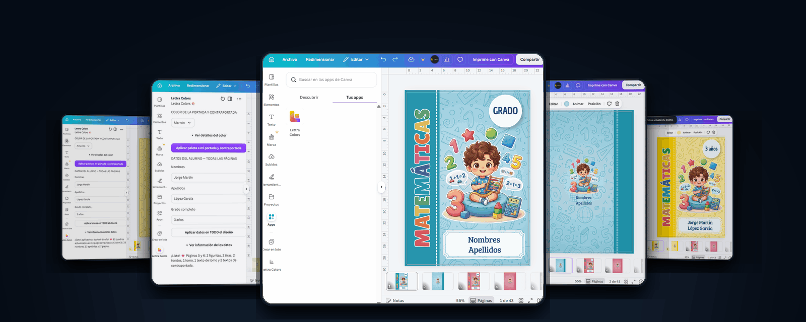

 

<h2 align="center">Sobre mí</h2>

Soy Meylin, creadora de **Lettra**, un emprendimiento de plantillas escolares digitales. Desarrollo herramientas para automatizar tareas de diseño, organizar productos y gestionar información comercial de mi emprendimiento.

Actualmente estoy aprendiendo **SQL, Python y fundamentos de datos**, con interés en Big Data, inteligencia artificial y automatización.

Aquí comparto proyectos que desarrollo para aplicar lo que voy aprendiendo a necesidades reales.

 

<h2 align="center">Tecnologías y herramientas</h2>

  

  React · TypeScript · Vite · Node.js · Express · PostgreSQL · Git · GitHub

 

<h2 align="center">Proyectos destacados</h2>

### 01. Lettra Colors

Aplicación integrada en Canva para automatizar la personalización de portadas, contraportadas y lomos de cuadernos escolares.

**Funcionalidades principales:**

- Selección entre 21 paletas de colores.
- Personalización de fondos, franjas e ilustraciones SVG compatibles.
- Reemplazo de nombres, apellidos y grado del estudiante.
- Personalización de elementos en distintas páginas de una plantilla compatible.

**Tecnologías:** React, TypeScript, Canva Apps SDK y SVG.

**Estado:** Versión 1.0 funcional en el entorno de desarrollo de Canva. No publicada en el catálogo de aplicaciones.

  

  <a href="https://github.com/blas-meylin/lettra-colors-canva-app">Ver repositorio y documentación</a>

 

---

### 02. Lettra Hub

Sistema web para administrar productos digitales, registrar ventas y visualizar indicadores comerciales de Lettra.

Desarrollé este proyecto para centralizar la información del emprendimiento en una aplicación con frontend, backend y base de datos relacional.

**Funcionalidades principales:**

- Registro, consulta, edición y eliminación de productos.
- Búsqueda de plantillas por nombre.
- Registro y edición de ventas con cálculo automático del total.
- Gestión de operaciones por TikTok Live y WhatsApp.
- Registro de pagos mediante Yape y Plin.
- Reportes de ingresos, unidades vendidas y productos destacados.
- Acceso privado mediante autenticación de administrador.

**Tecnologías:** React, TypeScript, Vite, Node.js, Express, PostgreSQL y Recharts.

**Infraestructura:** Neon (base de datos) y Render (despliegue web).

**Estado:** Versión 1.0 funcional y desplegada.

  <a href="https://lettra-hub-app.onrender.com">Ver aplicación web</a>
  &nbsp; | &nbsp;
  <a href="https://github.com/blas-meylin/lettra-hub">Ver repositorio y documentación</a>

La aplicación requiere autenticación para acceder a sus funciones administrativas. El repositorio puede requerir autorización si se mantiene privado.

 

---

<h2 align="center">Aprendizaje actual</h2>

  
  &nbsp;
  

  SQL · Python · Excel · Fundamentos de datos

- Consultas SQL y organización de información en bases de datos relacionales.
- Fundamentos de programación con Python.
- Análisis y organización de datos con Excel.
- Interés en arquitectura de datos, Big Data e inteligencia artificial.
- Aplicación práctica del aprendizaje mediante proyectos propios.

 

---

  Proyectos desarrollados para aprender, automatizar procesos y resolver necesidades de Lettra.

